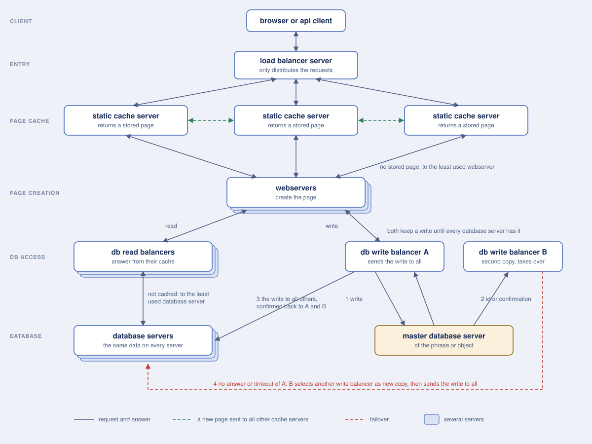

# Server structure of zukunft.com

The pod zukunft.com should run on five layers of servers, so that each layer can grow by adding servers and a change is
never kept by one server only.

## The layers

| layer | servers | task |
|---|---|---|
| entry | load balancer server | only distributes the requests to the static cache servers |
| page cache | static cache servers | return a stored page; without one, ask the least used webserver |
| page creation | webservers | create the page and read or write the data by the db balancers |
| db access | db read balancers, db write balancers | answer reads from their cache, keep a write until every database server has it |
| database | database servers, one of them the master of a phrase or object | store the data; every database server has the same data |

## Reading a page

1. The **load balancer server** sends the request to one of the static cache servers. It does not look into the
   request.
2. The **static cache server** checks if it has a stored page for the request and returns it.
3. If it has no stored page, it sends the request to the **least used webserver**. When the webserver has answered,
   the cache server returns the page and sends it to **all other static cache servers**, so that every cache server
   answers the next request for this page the same way.
4. The **webserver** creates the page. For the data that it needs it asks a **db read balancer**.
5. The **db read balancer** answers from its cache. If the request is not cached, it sends the request to the
   **least used database server** and caches the answer.

## Writing a change

1. If something must be updated, the webserver sends the change to a **db write balancer**.
2. The db write balancer sends the change to the **master database server of the phrase or object**.
3. The master database server returns the database id of a new row, or confirms the change, to **two db write
   balancers**, A and B. Both keep the change.
4. A sends the change to **all other database servers**. When every database server has confirmed the change to A,
   A and B delete the change.

## Failover of a write

If the connection to A fails or A does not answer in time, **B selects another db write balancer as the new second
copy**. Once the new copy has confirmed the change, B sends the change to the other database servers, so that
there are always two db write balancers that keep a change until every database server has it.
